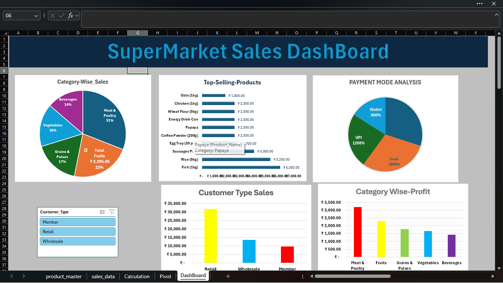

🛒 SuperMarket Sales Dashboard (Excel)

Overview
This project is an interactive Excel dashboard designed to analyze supermarket sales performance, product categories, customer purchasing behavior, and payment methods. The dashboard provides valuable insights through KPI metrics, charts, and slicers to support business decision-making.

Objectives
Monitor overall sales performance.
Analyze sales across different product categories.
Identify top-selling products.
Understand customer purchasing patterns.
Evaluate payment mode preferences.
Track category-wise profit generation.

Dashboard Features
KPI Metrics
Total Sales
Highest Sales
Average Sales
Lowest Sales

Sales Analysis
Category-Wise Sales Distribution
Top-Selling Products Analysis
Customer Type Sales Comparison
Category-Wise Profit Analysis

Customer Insights
Sales by Customer Type
Retail vs Wholesale vs Member Comparison
Customer Type Filtering using Slicer

Payment Analysis
Cash Transactions
UPI Transactions
Wallet Transactions

Interactive Features
Dynamic Slicer Filtering
Pivot Tables
Pivot Charts
Interactive Dashboard Design

Tools Used
Microsoft Excel
Pivot Tables
Pivot Charts
Slicers
Conditional Formatting
Data Analysis

Key Insights
Meat & Poultry contributed the highest overall sales.
Retail customers generated the highest revenue.
Rice and Fish ranked among the top-selling products.
Cash was the most preferred payment method.
Category-wise profit analysis highlighted the most profitable product groups.

Skills Demonstrated
Excel Dashboard Development
Data Visualization
Business Analytics
Data Analysis
KPI Reporting
Pivot Table Analysis
Interactive Dashboard Design

Dashboard Preview
Dashboard Screenshot
